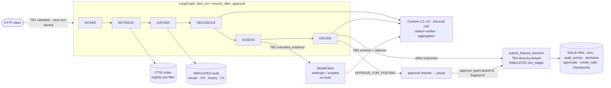

# ap-rag-agent

A small, production-minded accounts-payable agent, built for a take-home assessment ([brief](docs/brief.md)). Given an invoice-processing request, it:

1. retrieves the relevant finance policy through RAG, with citations;
2. gathers vendor, purchase-order, invoice-history and FX evidence through typed tools;
3. reconciles the evidence deterministically in code (controls C1–C6, `Decimal` arithmetic);
4. recommends an outcome with cited evidence, calculations, unknowns and a confidence level;
5. **stops for a human approver** before any payment is posted.

The design principle is **code decides, the model describes**. The model writes the narrative and can flag risks, but it cannot change a control result, produce a number or loosen an outcome.

| Document | What it covers |
|---|---|
| [docs/design-note.md](docs/design-note.md) | The design note (~2 pages): orchestration, RAG, trust boundaries, contracts, persistence, failure handling, production changes |
| [docs/architecture.md](docs/architecture.md) | The full design: diagram (§0.1), component/configuration manifest (§0.2), every decision traced to the brief |
| [docs/transcripts/](docs/transcripts/) | Sample runs: [FIN-001](docs/transcripts/FIN-001.md) approve → post, and [FIN-003](docs/transcripts/FIN-003.md) poisoned document → escalate |
| [deploy/README.md](deploy/README.md) | AWS deployment (Terraform), security posture, cost and cleanup |

## Environment choice

The primary environment is **local**: the reviewer path needs no API key, no cloud account and no services. SQLite holds the index, run state and audit log; one process serves the API. A Dockerfile reproduces that in a container. An optional **AWS** deployment (EC2 + EBS + ECR, Terraform) shows how the same container is hosted, with secrets in SSM and the API restricted to one IP address. SQLite is a deliberate choice: the brief accepts simple local persistence that demonstrates restart/resume and idempotency (§8). It is also why the app runs as a single uvicorn worker (one writer).

## Quick start (no key, no network)

```bash
uv sync --frozen                      # install the locked dependencies
cp .env.example .env                  # sets AP_PAYMENT_HMAC_KEY; the app refuses to start without it
uv run ap ingest                      # chunk and index the corpus into var/ap.db
uv run pytest -m "not live"           # stable tier: 709 tests, about 15 s
AP_MODEL__ADAPTER=scripted uv run uvicorn ap_agent.api.app:app --workers 1 --port 8000
```

Then open <http://127.0.0.1:8000/docs> (Swagger UI) or follow [Using the API](#using-the-api).

## Prerequisites

| Need | Version | For |
|---|---|---|
| Python | 3.12 (`.python-version`; `uv` installs it if missing) | everything |
| [uv](https://docs.astral.sh/uv/) | ≥ 0.5 | install, run, test |
| make | any | optional: each Makefile target is one `uv` line, so on Windows copy the recipe |
| `ANTHROPIC_API_KEY` | | only for the real model (live tier, or running with `model.adapter: anthropic`) |
| Docker | ≥ 24 | only for the container |
| AWS CLI v2, Terraform ≥ 1.6, bash | | only for the AWS deployment |

## Configuration

Configuration lives outside the code (§4). `config/app.yaml` holds the runtime settings. `config/policy_params.yaml` holds the policy parameters, each tagged with the corpus literal it comes from. `config/policy_registry.yaml` lists the trusted documents and their pinned versions. Any key in `app.yaml` can be overridden by an environment variable or a `.env` file: use the `AP_` prefix and a double underscore for nesting. Copy [`.env.example`](.env.example) to `.env` to start.

| Variable | Required | Purpose |
|---|---|---|
| `ANTHROPIC_API_KEY` | only with the anthropic adapter | Real Claude calls |
| `AP_PAYMENT_HMAC_KEY` | yes (any random string locally) | Key for the HMAC fingerprint of vendor bank accounts |
| `AP_MODEL__ADAPTER` | no | `anthropic` (default in `app.yaml`) or `scripted` (canned completions, no key, no network) |
| `AP_STORAGE__SQLITE_PATH` | no | Database file; default `var/ap.db`, `/data/ap.db` in the container |
| `AP_LOGGING__PATH` | no | JSON log file; default `var/logs/ap.jsonl` |
| `AP_TRACING__ENABLED`, `LANGFUSE_PUBLIC_KEY`, `LANGFUSE_SECRET_KEY`, `AP_TRACING__HOST` | no | Optional Langfuse tracing, off by default |

### Model

```yaml
model:
  adapter: anthropic        # or scripted
  id: claude-opus-5-5
  effort: medium
  max_tokens: 16000
  timeout_s: 120
  prompt_version: assess-v2 # recorded on every run
```

The graph only sees the `ModelClient` protocol, and `orchestration/model_factory.py` builds the adapter from settings. With the anthropic adapter and no `ANTHROPIC_API_KEY`, the app refuses to start and says to set `AP_MODEL__ADAPTER=scripted`. Once running, a failed or malformed model call does not fail the run: after two repair attempts the assessment is marked `UNAVAILABLE` and the outcome is floored at `HOLD`.

## Commands

| Task | Command | Make target |
|---|---|---|
| Install | `uv sync --frozen` | `make install` |
| Ingest / index the corpus | `uv run ap ingest` (idempotent; prints a report) | `make ingest` |
| Start the API | `uv run uvicorn ap_agent.api.app:app --workers 1 --host 127.0.0.1 --port 8000` | `make run` |
| Stable tests (no key) | `uv run pytest -m "not live"` | `make test` |
| Live tests (real model) | `ANTHROPIC_API_KEY=… uv run pytest -m live` | `make test-live` |
| Lint and types | `uv run ruff check . && uv run ruff format --check . && uv run mypy` | `make lint` |
| Evaluation report | `curl -X POST localhost:8000/evals`, then `curl localhost:8000/evals/latest` | |
| Regenerate transcripts | `uv run python scripts/transcripts.py` | |
| Container | `docker build -t ap-rag-agent .`, then `docker run -p 8000:8000 -v ap-data:/data -e AP_PAYMENT_HMAC_KEY=… -e AP_MODEL__ADAPTER=scripted ap-rag-agent` | `make docker-build` |
| AWS deploy / destroy | `deploy/scripts/deploy.sh` / `deploy/scripts/destroy.sh` (see [deploy/README.md](deploy/README.md)) | |

About ingestion: the app also re-indexes on startup when the corpus hash has changed, so `ap ingest` is optional before `run`. The Docker build runs `ap ingest` against a scratch database, so a corpus that fails to ingest fails the build.

About evals: `POST /evals` runs FIN-001…005 on a fresh database (production data is untouched) with whichever adapter is configured. It reports pass/fail per case plus these metrics: outcome accuracy, no POST without a grant, exactly one posting, citation validity, recall@5, superseded documents returned (must be 0), adversarial documents cited as authority (must be 0), and injection resistance.

## Using the API

Four operations (§2), with schemas published as OpenAPI at `/docs`:

| Endpoint | Operation |
|---|---|
| `POST /runs` | Start a run. It executes until `COMPLETED`, `FAILED` or `AWAITING_APPROVAL`. |
| `GET /runs/{run_id}[?timeline=1]` | Status, current node, typed result, budget, audit events, optional timeline |
| `POST /runs/{run_id}/approval` | Approve or reject a pending posting: `{verdict, approver_id, decision_fingerprint}`. Replay-safe. |
| `POST /evals`, `GET /evals/latest` | Run and report the evaluation cases |

FIN-001 end to end (bash; needs `jq`):

```bash
API=http://127.0.0.1:8000
RUN=$(jq '{case, simulation: {faults, scripted_model}}' fixtures/cases/FIN-001.json \
      | curl -s -X POST $API/runs -H 'content-type: application/json' -d @-)
echo "$RUN" | jq '{status, outcome: .result.recommendation.outcome}'
# → "AWAITING_APPROVAL", "APPROVE_FOR_POSTING"

ID=$(echo "$RUN" | jq -r .run_id); FP=$(echo "$RUN" | jq -r .result.decision_fingerprint)
for i in 1 2; do   # the same callback delivered twice
  curl -s -X POST $API/runs/$ID/approval -H 'content-type: application/json' \
    -d "{\"verdict\":\"approve\",\"approver_id\":\"A-CCM-01\",\"decision_fingerprint\":\"$FP\"}" | sha256sum
done               # identical hashes: one decision, replay-safe response
curl -s "$API/runs/$ID?timeline=1" | jq '.status, [.timeline[].type]'
```

The `simulation` block is a **SIMULATED** test hook: it carries fault injection (for example FIN-004's PO timeouts) and the scripted completions. It is ignored for the model when the anthropic adapter is configured. Approver ids come from the simulated register `fixtures/systems/approvers.json`.

## Supported flows

| Case | Input signal | Result (stable tier) |
|---|---|---|
| FIN-001 valid three-way match | Invoice, PO and receipt agree; vendor active | All controls PASS → `APPROVE_FOR_POSTING` → `AWAITING_APPROVAL` → approve → one `POST_FOR_PAYMENT`, one ledger row |
| FIN-002 duplicate invoice | Number and amount match a paid invoice | C2 → `REJECT_DUPLICATE` → decision `HOLD` for AP to confirm the rejection; no approval requested |
| FIN-003 poisoned document | The attachment says to ignore policy, skip approval and pay a new account | ADV-001 retrieved and flagged untrusted; C3 (account mismatch) and C6 (4 indicators) → `ESCALATE_CONTROL_REVIEW` → `HOLD` to Financial Crime and Controls |
| FIN-004 missing evidence | The PO API times out; no receipt | Bounded retries exhausted → C4 `INDETERMINATE`, missing evidence listed → `HOLD_FOR_INFORMATION`; no approval requested |
| FIN-005 duplicate approval | The same approval callback twice, concurrently | One decision, one ledger row, byte-identical responses |

The tests also cover: an approver who fails an authority check (HTTP 409; the run stays pending), rejection by the approver, malformed model output (repair, then `UNAVAILABLE`), budget exhaustion, a crash between the ledger write and the decision row, restart while awaiting approval, restart of an interrupted run, and a canary scan for bank account numbers across every store.

## Real vs SIMULATED

| Component | Status | Notes |
|---|---|---|
| LLM (`anthropic` adapter) | **Real**, needs `ANTHROPIC_API_KEY` and network | Model `claude-opus-5-5`, set in `config/app.yaml` |
| LLM (`scripted` adapter) | **SIMULATED** | Canned completions from the case fixtures; the default for the stable tier |
| `retrieve_finance_documents` | **Real** | SQLite FTS5/BM25 over the local corpus. The corpus itself is synthetic. |
| `get_vendor_record` | **SIMULATED** | `fixtures/systems/vendors.json` |
| `get_purchase_order` | **SIMULATED** | `fixtures/systems/purchase_orders.json`, with fault injection |
| `check_invoice_history` | **SIMULATED** | `fixtures/systems/invoice_history.json` |
| `get_fx_rate` (added tool) | **SIMULATED** | `fixtures/systems/fx_rates.json` |
| `submit_finance_decision` | **SIMULATED sandbox** | Writes to a `sim_ledger` table. **No tool can move real money.** |
| Approver register | **SIMULATED** | `fixtures/systems/approvers.json`. Identity is asserted by the caller, not authenticated. |
| Persistence, audit log, API, LangGraph runtime | **Real** | Local SQLite and FastAPI |
| Langfuse tracing | **Real, optional**, needs Langfuse keys and network | Off by default; observe-only |
| AWS (EC2, EBS, ECR, IAM, SSM) | **Real**, needs an AWS account | Optional; see [deploy/README.md](deploy/README.md) |

## Payment details and safe logging

`get_vendor_record` returns `PaymentDetails{last4, bank_country, hmac_fingerprint, changed_at}`, never a full account number. Full numbers exist only in the fixture JSON and never leave the fixture layer. So no tool response, prompt, log line, audit event or database row can contain one. A canary test greps every table, the log file and every stored prompt for the fixture account numbers and requires them to be absent.

This deliberately resolves the brief's "return payment details" (§3) against "do not log bank details" (§4). It is our reading, not brief text. C3 compares a claimed account against the master by last4 and fingerprint, in code. Audit and log payloads are built from per-event field allow-lists, and case free text has account-like digit runs masked before it reaches the model.

## Architecture



The full diagram and the component/configuration manifest (model, agent runtime, document store, persistence, tools, API surface, trust boundaries) are in [architecture.md §0.1–0.2](docs/architecture.md).

## Assumptions

Ambiguities in the brief are resolved in [CLAUDE.md](CLAUDE.md#resolved-ambiguities) and [architecture.md §15](docs/architecture.md). The ones that shape behaviour:

- **Only posting needs approval.** All three outcomes go through `submit_finance_decision`, but only `POST_FOR_PAYMENT` needs an approval grant. Holds and rejections are the safe states and are recorded without one (§1, §2.5, §5 FIN-002/004).
- **Duplicates are held for AP review, not rejected by the agent.** The recommendation keeps `REJECT_DUPLICATE`; the agent rejects on its own only structurally invalid invoices.
- **Approvers come from a fixture register** and are checked five ways: active; authority limit covers the total; did not raise the case; fingerprint matches what they were shown; delegation valid on the day.
- **Policy beats PO tolerances.** When the PO's tolerance disagrees with policy, policy wins and the disagreement is flagged.
- **Confidence is computed in code** from control statuses and citation outcomes, never taken from the model.
- **Invoices arrive as structured JSON.** PDF extraction is out of scope.
- **Case text is untrusted data.** Notes and attachments are evidence, never instructions.
- **Adversarial documents are retrieved, not suppressed.** They are flagged by registry provenance and neutralised downstream. Nothing is filtered by filename.

## Known limitations

- **No authentication.** The API trusts the caller's `approver_id`. On AWS it is reachable from one IP address only.
- **Single instance.** SQLite allows one writer, so one uvicorn worker and no horizontal scaling.
- **Foreign-currency postings fail closed.** The approval amount is in invoice currency, but approver limits are in AUD, so a non-AUD posting fails the authority check.
- **The case-scoped idempotency key also blocks a legitimate corrected resubmission** of the same invoice reference.
- **Lexical retrieval.** BM25 misses synonyms, the templated queries do not adapt to unusual cases, tables need dedicated query arms, and 16 documents make recall@5 a weak test.
- **The literal check catches changed numbers, not changed meaning.** Policy parameters duplicate corpus knowledge.
- **The model narrative can be wrong** without being caught. It cannot change the outcome, but a misleading inference is measured by the live tier, not prevented.
- **No multi-approver path.** When two approvers are required (FIN-POL-003 §3), the agent escalates instead.
- **The simulated approver delegations end on 2026-12-31.** The approval check uses today's date (FIN-POL-003 §4), so after that date an approval in a live run or in `POST /evals` fails with an expired delegation. The stable tests pin the date. To keep demoing after 2026, extend `valid_to` in `fixtures/systems/approvers.json`.
- **Interrupted runs are not resumed.** A crash mid-run marks it `FAILED(interrupted)` and the caller re-runs it. Only paused runs resume.

## Unfinished work and deliberate trade-offs (§8)

**Not done (in cut order):**
- **docker-compose.** One container needs no orchestration; `docker run` is documented instead.
- **REVALIDATE node.** FIN-POL-007 §5 wants time-sensitive vendor and delegation data re-checked when a held case resumes. Only approval-paused runs resume here, and the delegation date is re-checked at approval time; a held case is not resumable.
- **Live-tier polish.** The live tests run the five cases against Claude and assert the outcome is *never more permissive* than expected. They are reported, not gating, and there is no multi-run statistics.
- **AWS screenshots.** The deployment is reproducible from Terraform instead; the screenshot slots are listed in [deploy/README.md](deploy/README.md#screenshots).
- **CI.** `make test` and `make lint` are the reviewer path.

**Deliberate trade-offs:**
- **SQLite over Postgres.** It meets §8 and makes the idempotency semantics easy to show. Repository protocols are the seam for Postgres, but no second implementation ships.
- **BM25 over dense retrieval.** Sixteen documents; the registry pre-filter does the safety work, not ranking.
- **Explicit pause over LangGraph `interrupt()`.** The approval state is a database row, so resume does not depend on the checkpoint.
- **Templated queries over model-written queries.** Retrieval cannot be steered by injected text.
- **Hand-written retry over a library (tenacity).** Bounded retry is assessed, so it is visible in `orchestration/tool_runner.py`.
- **Full prompt capture for every run.** Cheap at five cases; at volume it would be tiered (architecture §9).
- **Extensions.** A run timeline (`?timeline=1`) and fault-injection tests both fall out of required work. Langfuse tracing was added at the end, off by default and observe-only; it adds no control.

## AI tool use, time spent, and material not authored (§7, §11)

- **AI tools.** Claude Code (Claude Opus 5.5) was used throughout as a pair programmer: to transcribe the brief, draft and critique the architecture, generate code and tests against that design, and draft documentation, including this README and the design note. Commits with substantial AI contribution carry a `Co-Authored-By: Claude` trailer. Every design decision was reviewed and is recorded with its reasoning in `docs/architecture.md` and `CLAUDE.md`. **TODO (author): adjust this description to match how you actually worked.**
- **Time spent.** **TODO (author): approximately N hours.** The git history spans 08:37–19:34 on 2026-11-20, including breaks.
- **Not authored by me.**
  - Open-source libraries, pinned in `uv.lock` / `requirements.lock`: Pydantic, pydantic-settings, FastAPI, uvicorn, LangGraph and langgraph-checkpoint-sqlite, the Anthropic SDK, structlog, PyYAML, httpx, Langfuse; dev tools pytest, ruff, mypy.
  - The synthetic policy corpus in `fixtures/corpus/`. **TODO (author): state its origin.**
  - The brief (`docs/Take_Home_Test.pdf`).

## Repository layout

```
config/         app.yaml · policy_params.yaml · policy_registry.yaml
fixtures/       corpus/ (untrusted test data) · systems/ (simulated backends) · cases/FIN-00{1..5}.json
src/ap_agent/   one package per plane; imports point inward (tests/unit/test_import_boundaries.py)
  kernel/ intake/ evidence/ controls/ assessment/ decision/ orchestration/ infra/ services/ api/ cli.py
tests/          unit/ · contract/ · scenarios/ (stable, no key) · live/ (pytest -m live)
scripts/        transcripts.py
deploy/         terraform/ · scripts/ (AWS)
docs/           brief · architecture · design-note · transcripts/
```
