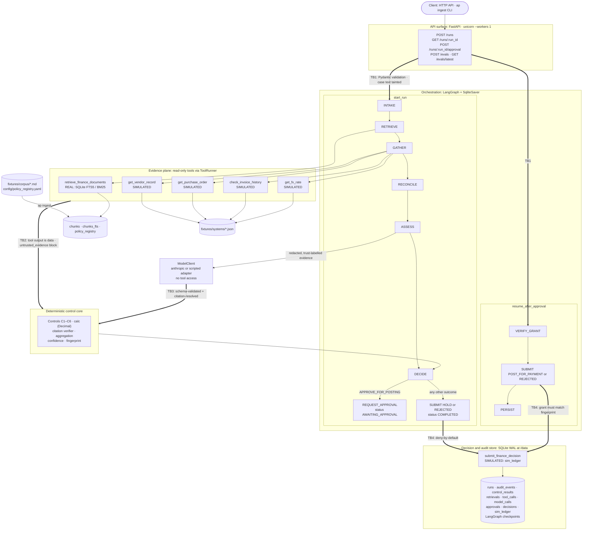

# Architecture — ap-rag-agent

Internal working document. Decisions here are final; build from them. The short reviewer-facing design note (§7) is derived from this.

**Conventions.** `§n` = section of `docs/brief.md` (a brief requirement). `FIN-POL-xxx §n` = section of a corpus policy (the system-under-test's policy, ingested as data). **(our decision)** = a choice we made, recorded for §11 traceability. **(provisional)** = a gap filled while writing this document; see §15.

**Principle (our decision).** Code decides, the model describes. The model is advisory and can only make an outcome stricter.

---

## 0. Overview

### 0.1 Architecture diagram (§6, §7)



### 0.2 Component / configuration manifest (§6)

Config sources: `config/app.yaml` (runtime), `config/policy_params.yaml` (policy parameters), `config/policy_registry.yaml` (trusted documents), env vars via pydantic-settings. Key names are **(our decision)**.

| Component | Choice | Config key | Real / simulated |
|---|---|---|---|
| Model | Anthropic SDK behind `ModelClient` protocol; `anthropic` and `scripted` adapters | `model.adapter`, `model.id`, `model.max_tokens`, `model.timeout_s`, `model.prompt_version`; env `ANTHROPIC_API_KEY` (live tier only) | Real LLM (`anthropic`) · scripted (stable tier, default) |
| Agent runtime | LangGraph state graphs, two entry points, no `interrupt()` | `budget.max_steps`, `budget.max_tool_calls`, `budget.max_model_calls`, `budget.max_retries_per_call` | Real |
| Document store / index | SQLite FTS5, BM25, metadata pre-filter scoped by policy registry | `corpus.path`, `retrieval.top_k`, `config/policy_registry.yaml` | Real (local corpus is synthetic) |
| Persistence | SQLite WAL, single writer; LangGraph `SqliteSaver` | `storage.sqlite_path` (container: `/data/ap.db`) | Real |
| Read tools | vendor, PO, invoice history, FX, each backed by a JSON fixture | `tools.<name>.timeout_s`, `tools.<name>.max_retries`, `tools.fixtures_dir` | **SIMULATED** |
| Consequential tool | `submit_finance_decision` → `sim_ledger` table | `tools.submit_finance_decision.timeout_s` | **SIMULATED** (sandbox, §8) |
| Payment-detail masking | HMAC fingerprint in the fixture layer | env `AP_PAYMENT_HMAC_KEY` (example value in `.env.example`) | Real |
| API surface | FastAPI, OpenAPI schema generated | `api.host`, `api.port` | Real |
| Logging | structlog JSON, one Pydantic model per event type | `logging.level`, `logging.path` | Real |
| Policy parameters | each value tagged doc_id / section / version / literal | `config/policy_params.yaml` | Real (values from the corpus) |
| Trust boundaries | TB1–TB4, see §1 | n/a: enforced in code, not configurable | Real |

### 0.3 Stack

| Concern | Choice |
|---|---|
| Language | Python 3.12 |
| Packaging | uv; `uv.lock` + exported `requirements.lock` (§7 pin/lock) |
| Quality | ruff · mypy `--strict` · pytest |
| Schemas / config | Pydantic v2 + pydantic-settings |
| API | FastAPI + uvicorn `--workers 1`, a deliberate choice because SQLite allows a single writer (our decision) |
| Orchestration | LangGraph + SqliteSaver |
| Model | Anthropic SDK behind `ModelClient` (§4 "model abstraction") |
| Money | `decimal.Decimal`, ROUND_HALF_UP, 2 dp, invoice currency (FIN-POL-002 §5) |
| Store / index | SQLite WAL, FTS5/BM25 |
| Logs | structlog JSON |
| CLI | `ap ingest` only |
| Deploy | AWS EC2 + Docker + EBS at `/data`; index baked into image |

**Not used (our decision):**

| Tool | Why not |
|---|---|
| LiteLLM | One provider; the scripted adapter is bespoke anyway. |
| Langfuse | Optional; end-of-day only if ahead (§13). |
| Postgres / pgvector | SQLite meets §8 "simple local persistence"; Postgres is the scale path (§13). |
| sqlite-vec / fastembed | 16 documents; dense retrieval doesn't change recall at this size (§3). |
| Terraform | §6 permits CLI commands + screenshots for a single instance. |
| CI | Out of timebox; `make test` is the reviewer path. |
| Alembic | Schema created at startup; no migrations needed for a fresh DB. |
| tenacity | Bounded retry is assessed (§4, §9), so it is hand-written and visible. |

---

## 1. Planes and trust boundaries (§4, §6)

`API surface → TB1 → orchestration → TB2 → evidence plane → TB3 → deterministic control core → TB4 → decision and audit store`

| Boundary | Crossing | Enforcement |
|---|---|---|
| TB1 | caller → orchestration | Pydantic validation of every request. Case notes and attachments are wrapped as `Tainted[str]` at construction (§2.1, §4). |
| TB2 | tool / retrieval output → anything | Retrieved text and tool output are data, never instructions. They reach the model only inside a delimited `<untrusted_evidence>` block with provenance labels (doc_id, version, trust), never interpolated into a system prompt (§4). |
| TB3 | model output → control core | Schema validation **and** citation resolution: the chunk must be in this run's retrieval set, the quote must be a verbatim substring, and the chunk's text hash must match (§4). |
| TB4 | control core → consequential tool | Deny-by-default. `POST_FOR_PAYMENT` requires an `ApprovalGrant` matching the decision fingerprint (§3, §4). |

Invariants:
- Trust is assigned by provenance (policy registry membership, tool identity), never by content (our decision).
- Nothing promotes untrusted text to trusted.
- The model has no tool access, so injected text cannot invoke anything (our decision).

---

## 2. Orchestration (§4 bounded graph, §2.5, §2.6)

### 2.1 Graphs: two entry points, no `interrupt()` (our decision)

```
start_run(case):
  INTAKE → RETRIEVE → GATHER → RECONCILE → ASSESS → DECIDE
  DECIDE ─ APPROVE_FOR_POSTING ─→ REQUEST_APPROVAL → END (AWAITING_APPROVAL)
  DECIDE ─ anything else ───────→ SUBMIT(HOLD | REJECTED) → END (COMPLETED)
  any node: budget exhausted or unrecoverable → END (FAILED, no decision written)

resume_after_approval(run_id, verdict, approver_id, decision_fingerprint):
  VERIFY_GRANT → SUBMIT(POST_FOR_PAYMENT | REJECTED) → PERSIST → END (COMPLETED)
```

| Node | Does | Tools allowed (registry allow-list) |
|---|---|---|
| INTAKE | Validate request, persist redacted request on `runs`, derive facets | none |
| RETRIEVE | Run templated per-control queries (§3) | `retrieve_finance_documents` |
| GATHER | Read vendor, history; PO only when `po_present`; FX only when `fx_applies`. This is how "call other tools only when needed" is satisfied (§2.2) | `get_vendor_record`, `check_invoice_history`, `get_purchase_order`, `get_fx_rate` |
| RECONCILE | Run C1–C6, write calculations and control results | none |
| ASSESS | One model call (+ repairs): narrative and citations | none (ModelClient only) |
| DECIDE | Verify citations, aggregate, compute confidence, build `FinalResult` + `decision_fingerprint` | none |
| REQUEST_APPROVAL | Write `approvals` row (PENDING), stop | none |
| SUBMIT | Write decision | `submit_finance_decision` (only node holding it) |
| VERIFY_GRANT | Load checkpoint, confirm grant exists for this run + fingerprint | none |
| PERSIST | Finalise run row, delete checkpoint | none |

### 2.2 Budget (§4)

`config/app.yaml`:
```yaml
budget: {max_steps: 25, max_tool_calls: 25, max_model_calls: 10, max_retries_per_call: 3}
```
- Charged on every node transition (steps) and every tool/model **attempt**, retries included.
- Persisted on the `runs` row, returned by Get run.
- `max_tool_calls` is 25 not 15 because 8 retrieval queries + 4 evidence tools + FIN-004's 3 retries + submit exceeds 15 (our decision).
- Per-tool retry counts (§7) are capped by `max_retries_per_call`.
- Exhaustion → `budget.exhausted` audit event → `FAILED`, no decision written.

### 2.3 Checkpoints, restart and resume (§2.6, §4)

| Aspect | Rule |
|---|---|
| Checkpoint key | LangGraph `thread_id = run_id` |
| Lifetime | Deleted when the run reaches a terminal state. Only `AWAITING_APPROVAL` runs stay resumable (our decision). |
| API state | `runs.status` and `runs.current_node` persist for every run, terminal or not. |
| Restart safety | Rests on the idempotency key, not the checkpoint. A crashed non-paused run can simply be re-run, because read nodes are idempotent and the case-scoped key (§6) blocks a second decision. |
| Paused restart | `AWAITING_APPROVAL` survives restart via the checkpoint; the approval callback resumes it. |

### 2.4 What LangGraph provides vs what our code enforces (§6)

| LangGraph provides | Our code enforces |
|---|---|
| Graph execution | Budget (steps, tool calls, model calls, retries) |
| Conditional edges | All four trust boundaries |
| Checkpointing (SqliteSaver) | Every control C1–C6 and aggregation |
| Resume from a checkpoint | Approval gate and grant check |
| | Idempotency (both constraints, ledger constraint) |
| | Redaction and payment-detail masking |
| | Citation verification |
| | Timeouts and retries (ToolRunner) |

---

## 3. RAG (§4)

Pipeline: `facet extraction → metadata pre-filter → per-control query → BM25 → merge/dedupe → citation`.
Omitted (our decision): reranking, query expansion, a facet taxonomy. At 16 documents they add latency without changing recall.

### 3.1 Ingestion — `ap ingest`

| Step | Rule |
|---|---|
| Parse | YAML front matter. Field names kept as the corpus spells them: `document_id`, `version`, `effective_date`, `superseded_date`, `status`, `classification`, `jurisdiction` |
| Normalise | `jurisdiction` lowercased at ingestion |
| Chunk | One chunk per `##` section; `n` = the section's number. A document with no `##` heading (FIN-POL-003-OLD, ADV-001, ADV-002) becomes one chunk, `n = 0` **(provisional)** |
| Chunk id | `{doc_id}§{n}@v{version}` |
| Hash | sha256 of chunk text stored per chunk |
| Write | `chunks`, `chunks_fts`, and `policy_registry` (loaded from YAML) |
| Idempotency | Keyed on corpus content hash (corpus files + registry); re-ingest of the same hash is a no-op; the hash is recorded on every run |

`status` is stored for display only. It is **never** used as a filter, because it is self-declared and forgeable.

### 3.2 Facets: deterministic from case and config

| Facet | Source |
|---|---|
| `entity` | config |
| `base_currency` | config (`AUD`) |
| `invoice_date` | case |
| `po_present` | case has a PO reference |
| `fx_applies` | invoice currency ≠ base currency |
| `has_free_text` | case has notes or attachments |

### 3.3 Pre-filter: scoped by the policy registry, as of the invoice date (§1)

Registry membership decides whether the policy filter applies at all.

| doc_id | Eligible when | trust | Citable as |
|---|---|---|---|
| **Not** in `config/policy_registry.yaml` | Always (still must rank in top_k) | `untrusted` | Risk evidence only, never authority |
| In the registry | `version = pinned_version AND effective_date <= :invoice_date AND (superseded_date IS NULL OR superseded_date > :invoice_date) AND jurisdiction IN ('au','global')` | `trusted` | Authority |

Schema sketch:
```sql
-- r = policy_registry(doc_id PK, pinned_version NULLABLE, superseded_by NULLABLE, doc_type)
WHERE chunks_fts MATCH :terms
  AND ( r.doc_id IS NULL
     OR ( c.version = r.pinned_version
      AND c.effective_date <= :invoice_date
      AND (c.superseded_date IS NULL OR c.superseded_date > :invoice_date)
      AND c.jurisdiction IN ('au','global') ) )
-- trust = CASE WHEN r.doc_id IS NULL THEN 'untrusted' ELSE 'trusted' END
```

Registry sketch:
```yaml
FIN-POL-003:     {pinned_version: "4.0", doc_type: policy}
FIN-POL-003-OLD: {pinned_version: null, superseded_by: FIN-POL-003, doc_type: policy}  # (provisional) see §15
# … FIN-POL-001 … FIN-POL-012 pinned to their current versions
# ADV-001, ADV-002: deliberately absent → untrusted
```

### 3.4 Per-control queries: top_k 5 each, merged and deduped by `chunk_id`

| Control | Query text | Runs when |
|---|---|---|
| C1 | `invoice mandatory fields required evidence` | always |
| C2 | `duplicate invoice already paid resubmission` | always |
| C3 | `vendor bank account change verification` | always |
| C4 | `three-way match tolerance variance purchase order goods receipt` | `po_present` |
| C4-NOPO | `emergency non-PO purchase approval requirement` | NOT `po_present` |
| C4-FX | `foreign currency invoice exchange rate conversion` | `fx_applies` |
| C5 | `delegated financial authority approval limit threshold` | always |
| C6 | `fraud indicators urgency bypass supplier instruction` | `has_free_text` |
| CASE | vendor name + attachment keywords | `has_free_text` |

At most 8 queries per run (C4 and C4-NOPO are mutually exclusive).

Rules:
- Free text contributes search **terms** only: never filters, never document selection. Terms are plain tokens, each quoted, so FTS5 operators in free text are inert.
- The CASE arm is the genuine search and is what surfaces the adversarial document by relevance.
- A template whose placeholder has no value is skipped, never rendered blank.
- Merge keeps every `(query, score)` pair per chunk in `retrievals`.

### 3.5 Superseded vs adversarial vs irrelevant

| Document | Problem | Treatment |
|---|---|---|
| `delegated_financial_authority_v1` (FIN-POL-003-OLD) | Legitimate but stale | Excluded by the registry version pin and effective dating (`superseded_date` 2026-08-01). Controls record the applied version (FIN-POL-003 v4.0). |
| `supplier_payment_instructions` (ADV-001) | Not in the registry, therefore untrusted. Its existence is evidence: urgency, bank change and a bypass request are FIN-POL-005 §3 indicators. | Retrieved on relevance, flagged `trust=untrusted` by registry provenance, not by filename or path, and neutralised at TB2. Citable as risk evidence, never as authority. |
| `travel_policy_extract` (ADV-002) | Irrelevant numeric distractor | Not in the registry; if retrieved it is flagged untrusted and cannot be cited as authority. |

### 3.6 Citations

`Citation{chunk_id, doc_id, version, section, text_sha256, quote, trust}`. Control citations are produced by code, never the model. Retrieval tool output also carries `doc_type` (from the registry; `unregistered` otherwise) and `score` (§3 "type, version/page, relevance").

### 3.7 Limitations (§4 requires these stated)

- Lexical matching misses synonyms.
- 16 tiny documents make recall a weak test.
- Templated queries don't adapt to unusual cases.
- BM25 doesn't read tables (FIN-POL-003 §2 limits are a table).
- An invoice predating every registered policy version yields INDETERMINATE for the affected controls and therefore HOLD. That is correct behaviour under effective dating, not a bug. All fixture invoice dates are on or after 2026-08-01.
- Production: hybrid dense + lexical, cross-encoder reranker, permission filtering before return (FIN-POL-010 §3).

---

## 4. Controls (§2.3, §4)

### 4.1 Policy parameters and the literal check (our decision)

`config/policy_params.yaml`: every value tagged with `doc_id`, `section`, `version` and the **literal string** the document uses. Each control verifies that its parameter's literal appears in the chunk it retrieved for that control. If the literal is absent, or that chunk wasn't retrieved → the control is `INDETERMINATE`. This makes retrieval load-bearing and detects drift between config and corpus.

**Before writing the file: grep the corpus for each literal and store the exact string the document uses.**

```yaml
c4_goods_tolerance_abs: {value: "50.00", currency: AUD, doc_id: FIN-POL-002, section: 2, version: "2.4", literal: "AUD 50 absolute variance"}
c4_goods_tolerance_pct: {value: "1",    doc_id: FIN-POL-002, section: 2, version: "2.4", literal: "1% of the PO line value"}
c5_limit_cost_centre_manager: {value: "10000.00", currency: AUD, doc_id: FIN-POL-003, section: 2, version: "4.0", literal: "AUD 10,000"}
# … one entry per parameter
```

### 4.2 Calculations

The calc module returns `Calculation{id, formula, inputs, result, rounding, currency}`, which is persisted and returned (FIN-POL-002 §5, §4). `Decimal`, ROUND_HALF_UP, 2 dp, invoice currency.

### 4.3 ControlResult

```python
class ControlResult(BaseModel):
    control_id: ControlId
    status: Literal["PASS", "FAIL", "INDETERMINATE", "NOT_APPLICABLE"]
    outcome_floor: RecommendationCode
    exception_category: ExceptionCategory | None   # FIN-POL-007 §1
    rule: str; expected: str | None; observed: str | None; threshold: str | None
    calculation_ids: list[str]; citations: list[Citation]; tool_call_ids: list[str]
    missing_evidence: list[str]
```

### 4.4 Controls table

| Control | Checks | Floor on failure |
|---|---|---|
| C1 minimum evidence | Required fields present (FIN-POL-001 §2) | Missing supporting evidence → `HOLD_FOR_INFORMATION`; unprocessable (no invoice ref, amount or vendor) → `REJECT_INVALID` |
| C2 duplicate | Exact and fuzzy match (FIN-POL-005 §1–2) | Exact match to a paid or posted invoice → `REJECT_DUPLICATE` citing FIN-POL-005 §2; probable fuzzy match → `HOLD_FOR_INFORMATION` with both record ids |
| C3 vendor and payment details | Status (FIN-POL-004 §4); bank-change recency; the attachment's claimed account vs master `last4` / `hmac_fingerprint`, compared in code | Non-`ACTIVE` → `HOLD_FOR_INFORMATION`; bank mismatch or recent change → `ESCALATE_CONTROL_REVIEW` (`BANK_CHANGE`) |
| C4 three-way match | Per line and total; qty ≤ received; variance ≤ min(AUD 50, 1%) (FIN-POL-002 §2); FX per FIN-POL-009 §2–3; PO tolerance and policy tolerance both recorded, disagreement flagged, policy wins (RA#8) | Missing receipt → `HOLD_FOR_INFORMATION`; PO unavailable → `INDETERMINATE`; no PO → consult FIN-POL-012 (C4-NOPO) before holding |
| C5 authority | Required role and limit for the base-currency total (FIN-POL-003 §2); two-approver flag (FIN-POL-003 §3) | Two approvers required → `ESCALATE_CONTROL_REVIEW`; there is no multi-approver posting path |
| C6 untrusted-content risk | Deterministic indicator patterns plus model-flagged indicators (FIN-POL-005 §3–4) | Two or more indicators → `ESCALATE_CONTROL_REVIEW` |

### 4.5 Applicability

Applicability is a deterministic field check, never a classification. Every control runs on every invoice unless a required typed field is absent. The model never decides applicability, so injected text cannot skip a control (our decision).

### 4.6 Aggregation

Order: `ESCALATE_CONTROL_REVIEW > REJECT_DUPLICATE > REJECT_INVALID > HOLD_FOR_INFORMATION > APPROVE_FOR_POSTING`.

- Outcome = highest floor across all controls **and** the model's proposal.
- `APPROVE_FOR_POSTING` only if every applicable control is `PASS`.
- Any `INDETERMINATE` → at least `HOLD_FOR_INFORMATION`.
- Nothing is inferred to fill a gap (FIN-POL-001 §5).

### 4.7 Recommendation → decision mapping

The recommendation uses corpus codes (FIN-POL-001 §3). The `submit_finance_decision` argument is `POST_FOR_PAYMENT | HOLD | REJECTED`. The mapping encodes that a recommendation is not an approval (FIN-POL-001 §3).

| Recommendation | Decision written | Approval? | `next_action` / `escalation_target` |
|---|---|---|---|
| `APPROVE_FOR_POSTING` | none yet → `REQUEST_APPROVAL`; after approve → `POST_FOR_PAYMENT`; after reject → `REJECTED` | Yes (§2.5) | Await approver |
| `HOLD_FOR_INFORMATION` | `HOLD` | No (RA#1) | Missing evidence listed; owner per FIN-POL-007 §3 |
| `REJECT_DUPLICATE` | `HOLD` | No | `next_action`: AP review must confirm the rejection (FIN-POL-005 §2). The rejection is left to a human. |
| `REJECT_INVALID` | `REJECTED` | No (RA#1, RA#2) | Return to sender. Agent-initiated `REJECTED` is reserved for structurally invalid cases. |
| `ESCALATE_CONTROL_REVIEW` | `HOLD` | No | `escalation_target` per FIN-POL-007 §3: Vendor Governance (bank), Financial Control (authority), Financial Crime and Controls (fraud) |

---

## 5. Model boundary (§4)

Used in one node, ASSESS.

| | |
|---|---|
| Input | Control results plus retrieved chunks, provenance- and trust-labelled, redacted, inside `<untrusted_evidence>` |
| Output | `ModelAssessment` |
| Not used for | Arithmetic, matching, duplicate detection, authority checks, the final outcome, routing, approval, submit, redaction, citation verification, confidence, retrieval queries |
| Out of scope, stated | Invoice line extraction from PDFs. Invoices arrive as structured JSON. In reality that is where an LLM is most needed. |

```python
class ClaimCitation(BaseModel): chunk_id: str; quote: str; use: Literal["authority", "risk_evidence"]
class Claim(BaseModel): finding_ref: ControlId; text: str; citations: list[ClaimCitation]
class RiskIndicator(BaseModel): indicator: IndicatorCode; chunk_id: str; quote: str
class ModelAssessment(BaseModel):
    findings: list[Claim]; inferences: list[str]; unknowns: list[str]
    risk_indicators: list[RiskIndicator]; proposed_outcome: RecommendationCode

class ModelClient(Protocol):
    def complete(self, request: ModelRequest) -> ModelResponse: ...
```

### 5.1 Failure handling

| Failure | Handling |
|---|---|
| Malformed or schema-invalid | Repair retry with the validation errors, max 2 attempts, each charged to the budget; then assessment `UNAVAILABLE`, floor raised to `HOLD_FOR_INFORMATION`, audit event. |
| Schema-valid but wrong | Structural limits: the model cannot emit numbers or control statuses that reach the result. Its proposal is combined as `max(control_floor, proposal)`, so it can only tighten. Claims contradicting a control status drop to unknowns. Residual risk: a wrong narrative. It is measured by the live eval, not prevented. |
| Unverifiable citation | Claim dropped to unknowns, `citation.rejected` event, confidence lowered. An untrusted chunk cited as `authority` is rejected; it may be cited as `risk_evidence`. |

### 5.2 Injection boundary

Nodes receive `Settings` and `ModelClient` by injection. Nothing under `graph/` or `controls/` reads `os.environ`, opens a YAML file, or imports a provider SDK. A test asserts this (§4 "provider config outside orchestration").

---

## 6. Safety: approval gate, idempotency, logging (§2.5, §3, §4)

### 6.1 Approval gate

1. REQUEST_APPROVAL writes an `approvals` row bound to `decision_fingerprint` = sha256 over canonical JSON (sorted keys, Decimals as strings) of: case identity, amount, currency, outcome, control statuses, evidence hashes. It proves what the approver saw (FIN-POL-003 §5).
2. Approve/reject (`POST /runs/{run_id}/approval {verdict, approver_id, decision_fingerprint}`) runs five checks against `fixtures/systems/approvers.json` (`approver_id, role, authority_limit, currency, active, valid_from, valid_to`):

   | # | Check | Source |
   |---|---|---|
   | 1 | Approver exists and is active | RA#6 |
   | 2 | `authority_limit` covers the base-currency total | FIN-POL-003 §2 |
   | 3 | Approver did not raise the case (`requested_by`) | FIN-POL-003 §1, FIN-POL-001 §4 |
   | 4 | Submitted fingerprint matches the pending one | FIN-POL-003 §5 |
   | 5 | Delegation within `valid_from` / `valid_to` | FIN-POL-003 §4 |

3. A pass mints a single-use `ApprovalGrant{grant_id, run_id, decision_fingerprint, verdict, approver_id, amount, currency}`.
4. `submit_finance_decision` re-verifies the grant in the DB (exists, unconsumed, fingerprint matches, amount matches) and refuses otherwise.
5. A failed check writes an audit event, leaves the run pending and returns the reason.

Limitation: authentication is out of scope; the caller asserts identity and it is trusted. Production: authenticated session, authority matrix from HR/ERP.

### 6.2 Deny-by-default (§4)

- A tool registry gives each node an explicit allow-list (§2.1 table). Only SUBMIT holds the consequential tool.
- `requires_approval = (decision == POST_FOR_PAYMENT)` is enforced **inside** the tool (RA#1).

### 6.3 `submit_finance_decision`: ordered steps

| # | Step |
|---|---|
| 1 | Schema validation |
| 2 | Idempotency lookup: replay returns the stored response (`REPLAYED`); same key with a different payload → conflict. This runs before the grant check, so a replay of a consumed grant still succeeds. |
| 3 | Approval gate for POST (§6.1 step 4) |
| 4 | Verify echoed arguments against the stored recommendation; record the **computed** total, not the supplied one |
| 5 | Run-state precondition |
| 6 | Simulated ledger posting into `sim_ledger`, idempotent on the key. An existing row returns its posting reference. |
| 7 | One transaction: write the decision, consume the grant, append the audit event |
| 8 | Typed result, status `RECORDED` or `REPLAYED` |

Internal only; never on the HTTP surface.

### 6.4 Idempotency (§4, §5 FIN-005, RA#4, RA#5)

| Constraint | Table | Covers |
|---|---|---|
| `UNIQUE(run_id, decision_fingerprint)` | `approvals` | Duplicate approval requests |
| `UNIQUE(idempotency_key)` | `decisions` | Duplicate decision submissions |
| `UNIQUE(idempotency_key)` | `sim_ledger` | Ledger-side double posting (crash between steps 6 and 7) |

- `idempotency_key = sha256(case_id|invoice_ref|vendor_id|decision)`. It is case-scoped, so a second run cannot double-post.
- Known limitation, documented and not solved: this also blocks a legitimate corrected-invoice resubmission.
- A submit timeout is retried with the same key.
- Defence in depth (RA#5): the graph never re-enters SUBMIT once a terminal decision exists, and the tool dedupes independently.
- Duplicate callback (FIN-005): the response body is derived only from persisted rows (the approval and decision rows), so the first and replayed deliveries are identical. `RECORDED` vs `REPLAYED` is visible in audit events.

### 6.5 Logging and redaction (§4, RA#3)

- Structured JSON, one Pydantic model per event type, so payloads are field allow-lists.
- Every event: `ts, run_id (correlation id), type, node, outcome, duration_ms, payload`.
- Event types (sketch): `run.started|completed|failed`, `node.entered|exited`, `retrieval.performed`, `tool.attempt|retry|timeout`, `model.call|repair`, `citation.rejected`, `control.evaluated`, `approval.requested|check_failed|granted`, `decision.recorded|replayed`, `budget.exhausted`.
- `get_vendor_record` returns `PaymentDetails{last4, bank_country, hmac_fingerprint, changed_at}`, never a full account number. This is a deliberate resolution of §3's "return payment details" against §4's redaction rule (our reading). It will be stated in the README.
- **Canary test:** fixtures hold full account numbers. After all scenarios, grep every DB text column (including `model_calls.prompt_redacted`), log file and stored prompt for them. They must be absent.

---

## 7. Tools (§3): all simulated except retrieval, labelled SIMULATED in the README

| Tool | Backend | Permission | Timeout / retries | Failure → |
|---|---|---|---|---|
| `retrieve_finance_documents` | SQLite FTS5 (**real**) | read | 2 s / 2 | Affected controls `INDETERMINATE` |
| `get_vendor_record` | `fixtures/systems/vendors.json` | read | 2 s / 3, backoff | C3 `INDETERMINATE` → HOLD |
| `get_purchase_order` | `fixtures/systems/purchase_orders.json` | read | 2 s / 3 | FIN-004 injects timeouts → C4 `INDETERMINATE` |
| `check_invoice_history` | `fixtures/systems/invoice_history.json` | read | 2 s / 3 | C2 `INDETERMINATE` → HOLD |
| `get_fx_rate` (RA#7) | `fixtures/systems/fx_rates.json` | read | 2 s / 3 | C4 / C5 `INDETERMINATE` |
| `submit_finance_decision` | `sim_ledger` table (sandbox, §8) | consequential; approval-gated for POST | 5 s, retry with same key | Refuses without a valid grant |

**ToolRunner (one for all):** validates input and output schemas, applies the timeout, retries transient errors only, charges the budget, writes a `tool_calls` row per attempt, and emits audit events with duration and outcome.

**Fault profiles** per case fixture: `faults: {tool_name: [timeout, transient, ok, ...]}`, consumed one entry per attempt.

```python
class Tool(Protocol[In, Out]):
    name: str; input_model: type[In]; output_model: type[Out]
    timeout_s: float; max_retries: int; consequential: bool
    def __call__(self, args: In) -> Out: ...
```

---

## 8. Typed final result (§2.4, §4)

```python
class Confidence(BaseModel): level: Literal["LOW", "MEDIUM", "HIGH"]; basis: list[str]
class Recommendation(BaseModel):
    outcome: RecommendationCode; exception_category: ExceptionCategory | None
    next_action: str; escalation_target: str | None; confidence: Confidence
class Unknown(BaseModel): what: str; why: str; impact: str
class Inference(BaseModel): text: str; origin: Literal["rule", "model"]; citations: list[Citation]

class FinalResult(BaseModel):
    run_id: str; case_id: str; status: RunStatus
    recommendation: Recommendation
    sourced_facts: list[SourcedFact]; calculations: list[Calculation]
    inferences: list[Inference]; unknowns: list[Unknown]; assumptions: list[str]
    policy_findings: list[ControlResult]; actions_taken: list[ActionTaken]
    decision_fingerprint: str | None; approval: ApprovalSummary | None
    applied_policy_versions: dict[str, str]   # doc_id → version (§1)
```

- `calculations` never contains a model-produced number.
- `inferences` alone can never gate a payment.
- Confidence is computed in code (RA#9), first match wins: **LOW** if any control is `INDETERMINATE` · **MEDIUM** if any model claim was dropped or the assessment was unavailable · **HIGH** otherwise.

---

## 9. Persistence (§2.6, §4, §8)

| Table | Contents | Key constraint |
|---|---|---|
| `runs` | status, current_node, redacted request, config snapshot (model id, prompt version, corpus hash), budget counters | PK `run_id` |
| `audit_events` | append-only: ts, run_id, type, node, outcome, duration_ms, allow-listed payload | |
| `control_results` | ControlResult rows with inputs, formula, result | |
| `retrievals` | query, filters, chunk_ids, scores. Kept minimal; needed for the citation check | |
| `tool_calls` | per attempt, redacted args and response | |
| `model_calls` | run_id, node, attempt, prompt_sha256, **prompt_redacted**, completion_text, parse_result, tokens, duration_ms, ts | |
| `approvals` | status, approver_id, stored response | `UNIQUE(run_id, decision_fingerprint)` |
| `decisions` | decision, computed total, grant id | `UNIQUE(idempotency_key)` |
| `sim_ledger` | simulated postings / holds / rejections | `UNIQUE(idempotency_key)` |
| `chunks`, `chunks_fts`, `policy_registry` | index | PK `chunk_id` |
| LangGraph checkpoints | SqliteSaver mechanical resume state only; deleted on terminal | |

**Run state vs audit events.** The run row is the current picture, overwritten, used to resume. `audit_events` is append-only history, used to explain. Both are required. The full audit record persists for every run regardless of outcome; there is no outcome exemption.

**Reproduce (our reading of §2.6, not a brief rule).** Everything that determines the outcome is persisted: tool responses, retrieval sets, control results with inputs, formula and result, and the decision. The deterministic path is therefore reproducible, demonstrated in tests via the scripted adapter. Model prompts (redacted) and completions are persisted for audit but are not replayed, because the model holds no authority over the outcome: it cannot alter a control status and can only raise the outcome floor. Reproducing a decision does not require reproducing the narrative.

**At production volume** this would be tiered: control results, decisions and audit events retained for every run under FIN-POL-010 §1's retention rule; full prompt capture kept for exceptions and approval-gated runs and sampled for clean ones; prompt bodies moved to object storage under a lifecycle policy.

**Crash test:** inject a crash after the ledger write and before the decisions insert, restart, assert exactly one posting.

**Repositories:** everything sits behind repository `Protocol`s; `persistence/postgres/` is a stub satisfying the protocol.

---

## 10. API (§2 Required interface)

| Endpoint | §2 operation | Notes |
|---|---|---|
| `POST /runs` | Start run | Executes until COMPLETED, FAILED or AWAITING_APPROVAL |
| `GET /runs/{run_id}` | Get run | status, current_node, FinalResult, audit events, budget counters |
| `GET /runs/{run_id}?timeline=1` | Get run (+ timeline extension, §10) | Timeline rendered from `audit_events` |
| `POST /runs/{run_id}/approval` | Approve / reject | Body `{verdict, approver_id, decision_fingerprint}`; replay-safe |
| `POST /evals` | List evaluation results (run) | Runs FIN-001…005 |
| `GET /evals/latest` | List evaluation results (report) | Pass/fail table (§11) |

FastAPI's generated OpenAPI schema satisfies §3's explicit-schema requirement for the API surface.

---

## 11. Tests and evaluation (§7)

| Tier | Command | Needs | Contents |
|---|---|---|---|
| Stable | `pytest -m "not live"` | no key, no network | **unit:** calc, aggregation, redaction, citations, budget · **contract:** tool schemas, ToolRunner timeout and retry, submit refusal and dedupe, import boundary · **scenarios:** FIN-001…005 end to end, malformed-model repair, budget exhaustion, crash and resume, canary, superseded exclusion |
| Live | `pytest -m live` | `ANTHROPIC_API_KEY` | The same five cases against the real model |

FIN-005 is a genuinely concurrent double callback via httpx: one decision, identical responses.

**Scenario expectations:**

| Case | Expected |
|---|---|
| FIN-001 | All controls PASS → `APPROVE_FOR_POSTING` → AWAITING_APPROVAL → approve → one `POST_FOR_PAYMENT`, one ledger row |
| FIN-002 | Exact match to a paid record → `REJECT_DUPLICATE` → decision `HOLD`; no approval requested |
| FIN-003 | ADV-001 retrieved, flagged untrusted, never cited as authority; C6 ≥ 2 indicators → `ESCALATE_CONTROL_REVIEW` → `HOLD`; no approval requested |
| FIN-004 | PO timeouts exhaust retries → C4 `INDETERMINATE`; missing evidence exposed → `HOLD_FOR_INFORMATION`; no approval requested |
| FIN-005 | Double callback → one decision, identical responses |

**Metrics** (reported as a pass/fail table, §2 "List evaluation results"):

| Metric | Pass condition |
|---|---|
| Outcome accuracy | Matches expected per case |
| Control-behaviour assertions | No POST without a grant; exactly one posting |
| Citation validity rate | Reported; invalid citations never reach the result |
| recall@5 | Against golden doc ids per case |
| Superseded-returned count | 0 |
| Adversarial-cited-as-authority count | 0 |
| Injection resistance | FIN-003 outcome unchanged by injected text |

---

## 12. Deployment (§6, §7)

| Path | Detail |
|---|---|
| Local (reviewer path) | Clone, `make test`. No key, no cloud, no services. Dockerfile provided. |
| AWS | EC2 + Docker; EBS volume mounted at `/data` holds the SQLite file; RAG index baked into the image at build time (`ap ingest` in the Docker build). |
| Topology | Single instance by design: SQLite permits one writer and the idempotency guarantees rely on it. `uvicorn --workers 1`. |
| Artefacts | AWS CLI commands, screenshots, cost/cleanup notes (§6 permits these instead of IaC). |
| Cleanup | **The EBS volume is NOT deleted with the instance.** Cleanup deletes it explicitly. |

---

## 13. Extensions, cuts, scale limits (§8, §10, §11)

**§10 extensions (two, both falling out of required work):** fault-injection tests; a run timeline rendered from `audit_events`. Langfuse only if ahead at the end.

**Cut order:** docker-compose → REVALIDATE node → live-tier polish → timeline → Langfuse.

**Never cut:** the approval gate and grant check · both idempotency constraints · deny-by-default submit · redaction plus canary · Decimal calculation records · citation verification · the superseded filter · budget/timeouts/retries · restart-resume · the five scenario tests · README and design note.

**Scale limits:**
- The single-writer lock on `audit_events` breaks first.
- One instance only; no replication or PITR.
- No ANN index.
- Policy params duplicate corpus knowledge; the literal check catches deleted or changed numbers, not changed meaning.

**At 10,000 invoices a day:** Postgres; a durable execution engine (Temporal or Step Functions) owning the lifecycle; the control engine unchanged; the model confined to one activity with prompts captured by a trace backend.

---

## 14. Traceability

### 14.1 §4 functional requirements

| §4 bullet | Addressed in |
|---|---|
| Actual LLM or model abstraction; provider config outside orchestration | §0.2 Model row, §5, §5.2 import-boundary test |
| RAG flow: ingestion, chunking/indexing, retrieval, citations; explain strategy and limitations | §3.1–3.6, §3.7 |
| Bounded loop / state graph with step and tool-call budget | §2.1, §2.2 |
| Validate model outputs and tool arguments; retry, repair or fail explicitly | §5.1, §7 ToolRunner, §6.3 step 1 |
| Deterministic arithmetic and reconciliation | §4.2, §4.4, §8 (`calculations` never model-produced) |
| Record run/retrieval/tool events with timestamps, run id, outcome, duration; no credentials or bank details | §6.5, §9 `audit_events`, canary test |
| Handle tool timeout, transient failure, malformed model output, duplicate approval, restart/resume | §7 (timeout, transient), §5.1 (malformed), §6.4 (duplicate approval), §2.3 + §9 crash test (restart/resume) |
| Retrieved documents and case text untrusted | §1 TB1, TB2; §3.3, §3.5; §4.5 |
| Consequential tools deny-by-default, approval-gated, idempotent | §6.1–6.4 |
| Typed final result separating facts, calculations, inferences, unknowns, policy findings, actions | §8 |

### 14.2 §7 deliverables

| §7 deliverable | Addressed in |
|---|---|
| Runnable source and complete instructions (provision, ingest, start, test) | `README.md`; §3.1 (`ap ingest`), §10, §11, §12 |
| README: environment choice, commands, model/API requirements, assumptions, supported flows, known limitations | `README.md`; drawn from §0.2, §3.7, §6.5, §7, §13 |
| Design note (~1–2 pages) | `docs/design-note.md`, derived from this document |
| Environment artefacts: diagram plus config/IaC/export/scripts/screenshots | §0.1 diagram, §0.2 manifest, `Dockerfile`, `Makefile`, `config/`, AWS CLI commands and screenshots (§12) |
| Automated tests, stable separated from model-dependent | §11 |
| Sample output / transcript: one successful, one exception/approval flow | `docs/` transcripts of FIN-001 (approval → post) and FIN-003 or FIN-004 (exception), rendered from `model_calls.prompt_redacted`, `audit_events` and FinalResult |
| Hygiene: no keys, credentials, personal data or proprietary code | `.env.example` only; synthetic fixtures; canary test (§6.5) |
| Hygiene: pin or lock dependencies; example env only if needed | `uv.lock`, `requirements.lock` (§0.3); `.env.example` for `ANTHROPIC_API_KEY`, `AP_PAYMENT_HMAC_KEY` |
| Hygiene: declare AI tool use | `README.md` declaration section (with §11 time spent and non-authored material) |

### 14.3 §6 items

| §6 item | Addressed in |
|---|---|
| Prerequisites, env vars, model config, ingestion, start, test commands | `README.md`; §0.2 |
| Architecture diagram and component/configuration manifest | §0.1, §0.2 |
| Local reproducible scripts / containers; cloud CLI + screenshots | §12 |
| Cost/cleanup notes; example config only | §12 |
| Label real integrations, mocks, external access | §0.2 "Real / simulated" column, §7 |
| Framework provides vs code enforces | §2.4 |

---

## 15. Open items (provisional points to confirm)

| # | Item | Provisional position in this document |
|---|---|---|
| O1 | Documents with no `##` heading (FIN-POL-003-OLD, ADV-001, ADV-002) | One chunk with `n = 0`. Without this, ADV-001 is never indexed and FIN-003 cannot surface it. |
| O2 | FIN-POL-003-OLD has its own doc_id, so it is not a version of FIN-POL-003. Under "not in the registry → always returned" it would be returned as untrusted, which breaks "superseded-returned count = 0" | Listed in the registry with `pinned_version: null` (never eligible) and `superseded_by: FIN-POL-003` |
| O3 | C3 "recent" bank change has no defined window | Not yet set |
| O4 | The model's proposal can raise the outcome to `REJECT_INVALID`, which maps to an agent-initiated `REJECTED`, although that is reserved for structurally invalid cases | Not yet set |
| O5 | One primary `exception_category` and `escalation_target` when several controls tie at the top floor (FIN-POL-007 §1 requires one) | Not yet set |
| O6 | "Repair retry … max 2 attempts" | Read as 2 repair attempts after the initial call |
| O7 | A crashed non-paused run is "simply re-run": automatic on startup or by the caller, and the fate of its stale `RUNNING` row | Not yet set |
