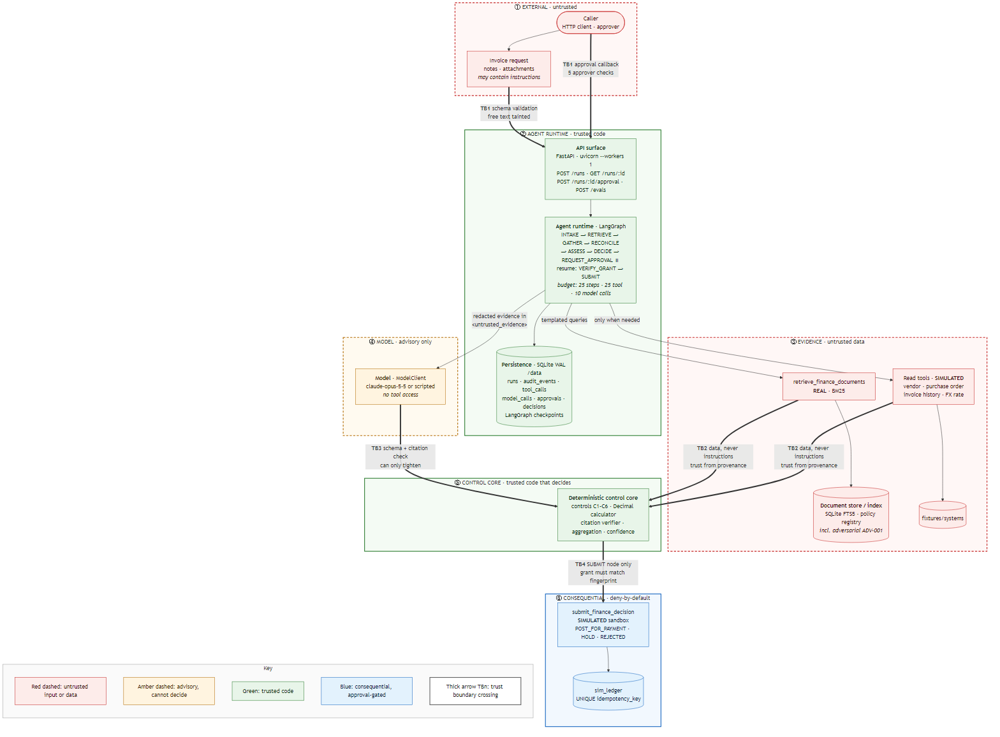

# Design note: ap-rag-agent

A bounded accounts-payable agent. It retrieves policy through RAG, reconciles invoice, PO, receipt and vendor evidence in code, and recommends an outcome. It stops for a human before any payment is posted. One principle runs through the design: **code decides, the model describes.** The model is advisory and can only make an outcome stricter. The full design, with every decision traced to the brief, is in [architecture.md](architecture.md). Section references (§n) point to the brief.

## 1. Orchestration

The agent runs as two LangGraph state graphs that share one SQLite checkpointer, keyed `thread_id = run_id`:

```
start_run:    INTAKE → RETRIEVE → GATHER → RECONCILE → ASSESS → DECIDE
              DECIDE ─ APPROVE_FOR_POSTING → REQUEST_APPROVAL → END (AWAITING_APPROVAL)
              DECIDE ─ anything else       → SUBMIT(HOLD | REJECTED) → END (COMPLETED)
resume:       VERIFY_GRANT → SUBMIT(POST_FOR_PAYMENT | REJECTED) → PERSIST → END
```

- **Explicit pause instead of `interrupt()`.** The pause is a real state: an `approvals` row plus run status `AWAITING_APPROVAL`. The approval callback is a separate entry point. Resume therefore survives a restart, and its input is reloaded from the database, so a lost checkpoint cannot strand an approved run.
- **Bounded by a budget** (§4): 25 steps, 25 tool calls, 10 model calls, 3 retries per call, set in `config/app.yaml`. Every node transition and every tool or model *attempt* is charged, retries included. When the budget runs out the run ends `FAILED` with an audit event, and no decision is written.
- **Least authority per node.** Each node has a tool allow-list. Only SUBMIT holds `submit_finance_decision`. GATHER calls the PO tool only when the case has a PO and the FX tool only when the invoice currency is not AUD (§2.2).

**What LangGraph provides vs what our code enforces** (§6). LangGraph provides graph execution, conditional edges and checkpoint/resume. Our code enforces the budget, all four trust boundaries, controls C1–C6, the approval gate, idempotency, redaction, citation verification, and timeouts and retries.

## 2. RAG design and its limitations

- **Ingestion** (`ap ingest`). The 16 Markdown documents are chunked one per `##` section, with ids of the form `{doc_id}§{n}@v{version}`. Each chunk stores a sha256 hash. Ingestion is idempotent on a corpus-plus-registry hash.
- **Index.** SQLite FTS5 with BM25. At 16 documents, dense retrieval and reranking add latency without improving recall.
- **Policy registry pre-filter** (`config/policy_registry.yaml`). Trust comes from *provenance*, never from content.
  - A registered document is eligible only at its pinned version, effective on the invoice date and in the AU or global jurisdiction. So the superseded authority matrix (FIN-POL-003-OLD) is excluded by a hard filter, not by ranking. The applied policy versions are recorded in the result.
  - An unregistered document, such as the adversarial ADV-001 or the irrelevant ADV-002, is still returned on relevance but labelled `untrusted`. It can be cited as risk evidence, never as authority. Nothing is filtered by filename.
- **Queries.** Up to 10 templated queries per run, one per control (C1–C6, plus arms for vendor status, the limits table, no-PO and FX), and one CASE arm built from the case's free text. Free text contributes quoted search terms only, so FTS5 operators in it are inert.
- **Literal check.** Each policy parameter in `config/policy_params.yaml` carries the exact literal its source uses, for example "AUD 50 absolute variance". A control is `INDETERMINATE` unless that literal appears in a trusted chunk retrieved in this run. This makes retrieval load-bearing and catches drift between config and corpus.
- **Limitations.**
  - Lexical search misses synonyms.
  - The templates do not adapt to unusual cases.
  - BM25 reads tables poorly: the FIN-POL-003 limits table needed its own query arm.
  - With 16 documents, recall@5 is a weak test.
  - The literal check catches deleted or changed numbers, not changed meaning.
  - Production would use hybrid dense and lexical retrieval with a cross-encoder reranker and permission filtering before results are returned (FIN-POL-010 §3).

## 3. Trust boundaries

A trust boundary is a point where data passes from a less trusted part of the system into a more trusted one, so the receiving side must check or contain it. The diagram groups components into zones by trust and marks each crossing TB1–TB4. Its source is [architecture.mmd](architecture.mmd).



| Boundary | What crosses | Threat | Control | Enforced in | Test that proves it |
|---|---|---|---|---|---|
| **TB1** caller → runtime | Invoice request, notes, attachments; approval callbacks | Malformed or hostile input; instructions hidden in case text (FIN-003); an approver without authority | Strict schemas with unknown fields rejected. Free text is wrapped as `Tainted`, whose `str()` hides the content. Five checks on every approver. | [`intake/case.py`](../src/ap_agent/intake/case.py), [`api/schemas.py`](../src/ap_agent/api/schemas.py), [`decision/approvals.py`](../src/ap_agent/decision/approvals.py) | [`test_invalid_request_is_rejected_at_tb1`](../tests/scenarios/test_api.py#L69), [`test_case_text_is_tainted_at_construction`](../tests/unit/test_domain.py#L31), [`test_tainted_str_hides_content`](../tests/unit/test_domain.py#L55), [`test_each_check_refuses_and_is_audited`](../tests/contract/test_approval_gate.py#L66) |
| **TB2** evidence → runtime and control core | Retrieved chunks, tool responses | A poisoned or irrelevant document steers the outcome; a superseded policy is applied; search syntax is injected | Trust comes from registry provenance, not content. Superseded versions are removed by a hard filter. Free text becomes quoted search terms. Evidence reaches the model only inside an escaped, labelled `<untrusted_evidence>` block. | [`evidence/rag/index.py`](../src/ap_agent/evidence/rag/index.py), [`assessment/prompt.py`](../src/ap_agent/assessment/prompt.py) | [`test_adversarial_attachment_surfaces_via_case_query_as_untrusted`](../tests/unit/test_rag_retrieval.py#L68), [`test_superseded_authority_policy_never_returned`](../tests/unit/test_rag_retrieval.py#L48), [`test_fts_operators_in_free_text_are_inert`](../tests/unit/test_rag_retrieval.py#L113), [`test_untrusted_text_is_delimited_labelled_and_escaped`](../tests/unit/test_prompt_redaction.py#L32) |
| **TB3** model → control core | The model's assessment | Hallucinated citations; an untrusted document cited as authority; the model talked into loosening or wrongly escalating the outcome | Schema validation, then two repair attempts, then `UNAVAILABLE`. Each citation must be in this run's retrieval set, verbatim, with a matching hash. Risk indicators must quote the case's own text. The proposal is capped (O4, O8) and can only tighten the outcome. | [`assessment/assess.py`](../src/ap_agent/assessment/assess.py), [`assessment/verify.py`](../src/ap_agent/assessment/verify.py), [`controls/aggregate.py`](../src/ap_agent/controls/aggregate.py) | [`test_forged_quote_is_rejected`](../tests/unit/test_citation_verify.py#L61), [`test_chunk_outside_the_retrieval_set_is_rejected`](../tests/unit/test_citation_verify.py#L70), [`test_untrusted_chunk_cannot_be_authority_but_can_be_risk_evidence`](../tests/unit/test_citation_verify.py#L77), [`test_risk_indicators_from_library_chunks_are_not_counted`](../tests/unit/test_citation_verify.py#L130), [`test_o4_model_reject_is_capped_at_hold`](../tests/unit/test_aggregate.py#L112), [`test_o8_ungrounded_escalation_is_downgraded_to_hold`](../tests/unit/test_aggregate.py#L139) |
| **TB4** control core → consequential tool | A finance decision | Payment posted without approval, against a different decision than the one approved, or twice | Deny-by-default. Only the SUBMIT node holds the tool. `POST_FOR_PAYMENT` needs a single-use grant bound to the decision fingerprint, checked inside the tool. Idempotency key plus UNIQUE constraints. | [`decision/submit.py`](../src/ap_agent/decision/submit.py), [`orchestration/tool_registry.py`](../src/ap_agent/orchestration/tool_registry.py) | [`test_post_without_a_grant_is_refused`](../tests/scenarios/test_resilience.py#L149), [`test_post_against_a_hold_recommendation_is_refused`](../tests/scenarios/test_resilience.py#L161), [`test_allow_list_denies_by_default`](../tests/contract/test_tool_runner.py#L226), [`test_fin_005_concurrent_double_callback`](../tests/scenarios/test_api.py#L95) |

**How to read the test column:** each entry is an automated test in `tests/` that exercises the control and fails if it breaks. Click a name to open its code. To run one: `uv run pytest -k <test_name>`. All of them run in the stable tier (`make test`).

The model has no tools, so injected text cannot invoke anything.

**Worked example (FIN-003).** One hostile input meets every boundary in turn ([transcript](transcripts/FIN-003.md); end-to-end test [`test_fin_003_injection_never_reaches_authority`](../tests/scenarios/test_fin_cases.py#L86)):
1. **TB1:** the poisoned attachment is accepted only as tainted text.
2. **TB2:** ADV-001 tops the case-text retrieval but is labelled untrusted.
3. **Controls:** C3 catches the claimed account in code (last4 8842 against 4417 on the vendor master), and C6 counts four fraud indicators.
4. **TB3:** the model's indicators count only because they quote the case's own text.
5. **TB4** is never reached. The run ends `HOLD` with no approval request.

## 4. Model and tool contracts

- **Model.** A `ModelClient` protocol with two adapters: `anthropic` (real Claude; the model id and limits live in config) and `scripted` (canned completions for the stable test tier). The model runs in one node, ASSESS, and returns a `ModelAssessment` containing findings, inferences, unknowns, risk indicators and a proposed outcome.
- **Model authority is capped.**
  - Its proposal combines with the control floor as `max(floor, proposal)`, capped at `HOLD` or `ESCALATE`.
  - It cannot propose a rejection.
  - An `ESCALATE` proposal counts only with a verified risk indicator (O8).
  - It never produces a number, a control status or the confidence level.
- **Malformed output.** The validation errors are fed back for up to two repair attempts. After that the assessment is `UNAVAILABLE` and the outcome floor is raised to `HOLD`.
- **Tools.** There are six, each with Pydantic input and output schemas, a timeout and a retry count from config:
  - `retrieve_finance_documents` (real FTS5);
  - `get_vendor_record`, `get_purchase_order`, `check_invoice_history` and `get_fx_rate`, all simulated over JSON fixtures. `get_fx_rate` was added because no brief tool supplies an exchange rate;
  - `submit_finance_decision`, simulated into a `sim_ledger` table. Nothing can move money (§8).

  One ToolRunner validates inputs and outputs, enforces the deadline, retries transient errors only, charges the budget, and records each attempt.
- **Payment details.** `get_vendor_record` returns `PaymentDetails{last4, bank_country, hmac_fingerprint, changed_at}`. Full account numbers never leave the fixture layer, so no prompt, log or table can contain one. A canary test greps every store for them.
- **Arithmetic.** All arithmetic is `Decimal`, ROUND_HALF_UP, 2 dp. Every operation returns a `Calculation{formula, inputs, result}` that is persisted and returned (§4).

## 5. Persistence and idempotency

SQLite in WAL mode with a single writer (hence `uvicorn --workers 1`). The `runs` row holds the current picture: status, node, budget and config snapshot. `audit_events` is append-only history, enforced by triggers. Everything that determines the outcome is persisted: tool responses, retrieval sets, control results with their inputs, formulas and results, and the decision. The deterministic path can therefore be reproduced. Redacted prompts and completions are kept for audit but not replayed, because the model has no authority over the outcome.

Duplicate approvals and replays are covered by three constraints: `UNIQUE(run_id, decision_fingerprint)` on approvals, and `UNIQUE(idempotency_key)` on both decisions and `sim_ledger`. The key is scoped to the case, so a second run cannot post twice. The graph also never re-enters SUBMIT once a decision exists (defence in depth). The approval response is rendered from stored rows and kept on the approval row, so a duplicate callback gets a byte-identical body (FIN-005, tested with two concurrent HTTP requests).

## 6. Failure handling

| Failure | Behaviour |
|---|---|
| Tool timeout / transient error | Bounded retry with backoff. Once retries are exhausted, the affected control is `INDETERMINATE`, which floors the outcome at `HOLD` and lists the missing evidence (FIN-004). Permanent errors are not retried. |
| Malformed model output | Two repairs, then `UNAVAILABLE` and a `HOLD` floor. Every attempt is recorded in `model_calls`. |
| Duplicate approval | The constraints above, a per-run lock, and a stored response replayed verbatim. |
| Crash between ledger write and decision row | Restart and redelivery find the ledger row by key, giving exactly one posting (tested). |
| Restart while paused | `AWAITING_APPROVAL` survives restart and the callback resumes it. A run interrupted while `RUNNING` is marked `FAILED(interrupted)` at startup, and re-running it cannot double-post. |
| Budget exhausted | The run ends `FAILED` with no decision written. |

## 7. Production changes

- **Data and orchestration.** Postgres instead of SQLite, which allows more than one instance (the single-writer lock is the first thing to break at scale). A durable workflow engine (Temporal or Step Functions) owning the run lifecycle. The control engine stays unchanged.
- **Identity.** Real approver authentication (OIDC) with the authority matrix taken from HR or ERP. Today the caller asserts approver identity and it is trusted.
- **Integrations and extraction.** Real ERP integrations behind the same tool schemas. Invoice PDF extraction (out of scope here; invoices arrive as JSON) is where a model is most needed.
- **Retrieval.** Hybrid retrieval with reranking and permission filtering. The policy registry is maintained by policy owners, not in YAML.
- **Observability and retention.** Tiered prompt capture, retained under FIN-POL-010. CloudWatch alarms. Backups to meet the seven-year retention period.
- **Network.** A private subnet behind an ALB with TLS.
